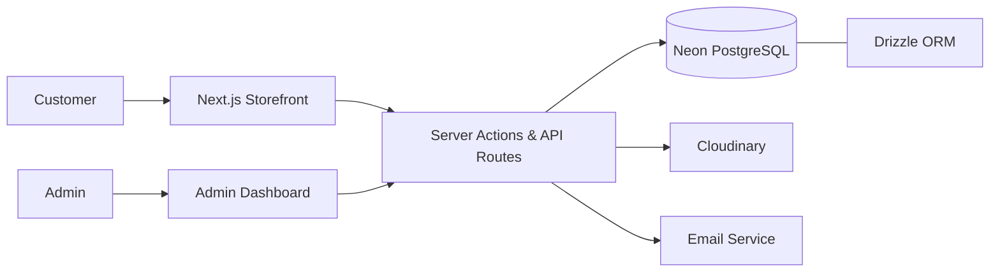

<div align="center">


# Aura Dial

### Luxury watches & eyewear e-commerce, built for Cash-on-Delivery markets.

A production-grade storefront and admin platform with instant checkout, order tracking, and full inventory management.

<br />

[](https://aura-dial-delta.vercel.app)


[**Live Demo**](https://aura-dial-delta.vercel.app) · [**Features**](#-features) · [**Architecture**](#-architecture) · [**Getting Started**](#-getting-started) · [**Screenshots**](#-screenshots)

</div>

---

## 📖 Overview

**Aura Dial** is a full-stack e-commerce platform for luxury timepieces and eyewear. It pairs a fast, mobile-first storefront with a secure, database-backed admin dashboard, so a store owner can run the entire business — catalog, orders, content, and settings — without touching code.

The checkout is designed around **Cash-on-Delivery (COD)**: no payment gateway, no account required. Customers place an order in seconds and track it later with just an order ID and phone number.

**Highlights**

- ⚡ Server-rendered with the Next.js App Router, with streaming `loading.tsx` states on every route
- 🔒 Hardened admin: hashed credentials, signed cookie sessions, CSRF protection, rate limiting, and audit logging
- 🧱 Type-safe end to end: TypeScript, Zod validation on client **and** server, and Drizzle ORM for the database
- ☁️ Serverless-ready: Neon Postgres, Cloudinary signed uploads, and zero-config Vercel deploys

---

## ✨ Features

### 🛍️ Storefront

| | Feature | Description |
|:-:|:--|:--|
| 🗂️ | **Catalog & Collections** | Curated watch and eyewear categories with filtering, sorting, and best-seller badges |
| 🖼️ | **Product Pages** | Image galleries, variants, and customer reviews with photo uploads |
| 🛒 | **Cart & Wishlist** | Persistent slide-over drawers powered by Zustand |
| 💳 | **COD Checkout** | Client-side validation plus server-side verification of every order |
| 📦 | **Order Tracking** | Live status lookup by order ID and phone number |
| 💬 | **WhatsApp Support** | Floating widget for instant customer inquiries |
| 🔎 | **SEO Ready** | Dynamic sitemap, robots rules, and Open Graph image |
| 📱 | **Responsive** | Mobile bottom navigation and layouts tuned for every screen size |
| 📡 | **Offline Awareness** | Connection banner that warns users when they lose network |

### 🔐 Admin Dashboard

| | Feature | Description |
|:-:|:--|:--|
| 📊 | **Executive Dashboard** | Sales metrics and performance at a glance |
| 🧾 | **Order Management** | Full lifecycle control with status updates |
| 🏷️ | **Products & Categories** | Complete CRUD for items, pricing, inventory, and categories |
| ⭐ | **Review Moderation** | Approve, review, and manage customer feedback |
| ☁️ | **Media Management** | Direct-to-Cloudinary uploads via signed requests |
| 📝 | **Content & Policies** | Edit store pages and policy text without redeploying |
| ⚙️ | **Store Settings** | Global settings, banners, and hero content |
| 🔑 | **Account Security** | Change email and password, forgot/reset password flow, session expiry handling |

---

## 🏗️ Architecture



**Request flow:** every mutation passes through Zod validation, then CSRF and rate-limit checks, then admin authorization where applicable, before touching the database via Drizzle.

### 🛡️ Security

| Concern | Approach |
|:--|:--|
| **Passwords** | Hashed with `bcryptjs` |
| **Sessions** | Secure cookie sessions signed with `ADMIN_SESSION_SECRET` |
| **CSRF** | Request origin verification on mutating routes |
| **Abuse protection** | Rate limiting on login, order, and password-reset endpoints |
| **Input validation** | Shared Zod schemas enforced server-side |
| **Error handling** | Safe error responses that never leak internals |
| **Auditing** | Admin actions recorded in an audit log |
| **Uploads** | Cloudinary signed uploads with server-side verification |

---

## 🛠️ Tech Stack

| Layer | Technology |
|:--|:--|
| **Framework** | [Next.js](https://nextjs.org/) (App Router) |
| **UI** | [React](https://react.dev/) · [Tailwind CSS](https://tailwindcss.com/) · [Lucide Icons](https://lucide.dev/) |
| **Language** | [TypeScript](https://www.typescriptlang.org/) |
| **Database** | PostgreSQL on [Neon](https://neon.tech/) (serverless) |
| **ORM** | [Drizzle ORM](https://orm.drizzle.team/) + Drizzle Kit |
| **State** | [Zustand](https://zustand-demo.pmnd.rs/) |
| **Validation** | [Zod](https://zod.dev/) |
| **Media** | [Cloudinary](https://cloudinary.com/) |
| **Auth** | Cookie sessions + `bcryptjs` |
| **Hosting** | [Vercel](https://vercel.com/) |

---

## 🗄️ Database Schema

| Table | Purpose |
|:--|:--|
| `products` | Catalog data: title, slug, pricing, stock, imagery, and status flags |
| `categories` | Watches, eyewear, and collection groupings |
| `orders` | Customer details, delivery information, and fulfillment status |
| `order_items` | Line items tied to each order |
| `reviews` | Customer ratings and review content |
| `admins` | Admin credentials and session data |
| `store_settings` | Global configuration, banners, and metadata |

---

## 📁 Project Structure

<details>
<summary><b>Expand the file tree</b></summary>

```text
aura-dial-store
├── public/                     # Brand assets and static images
├── scripts/                    # Seeding, preflight checks, review table setup
├── legal-drafts/               # Privacy, returns, shipping, and terms drafts
└── src/
    ├── app/
    │   ├── (store)/            # Public storefront routes
    │   │   ├── products/[slug]
    │   │   ├── collections/[slug]
    │   │   ├── checkout
    │   │   ├── order-success/[orderNumber]
    │   │   ├── track-order
    │   │   ├── policies/[slug]
    │   │   └── about · contact
    │   ├── admin/              # Admin app
    │   │   ├── (dashboard)/    # orders · products · categories · reviews
    │   │   │                   # pages · settings · account
    │   │   └── login · forgot-password · reset-password · session-expired
    │   └── api/                # Auth, orders, tracking, upload signing
    ├── components/
    │   ├── admin/              # Admin forms, nav, and tables
    │   └── store/              # Cart, wishlist, gallery, cards, header, footer
    ├── db/                     # Drizzle schema, migrations, seed data
    ├── lib/
    │   ├── auth/               # Sessions, password hashing, route guards
    │   ├── security/           # CSRF, rate limit, client IP, safe errors
    │   ├── validations/        # Zod schemas
    │   ├── queries/            # Typed data access (store + admin)
    │   ├── orders/             # Order creation logic
    │   └── cloudinary/         # Upload signing, verification, cleanup
    ├── store/                  # Zustand stores (cart, wishlist)
    └── proxy.ts                # Request interception
```

</details>

---

## 🚀 Getting Started

### Prerequisites

- Node.js 20+
- A [Neon](https://neon.tech/) PostgreSQL database
- A [Cloudinary](https://cloudinary.com/) account

### Installation

```bash
# 1. Clone the repository
git clone https://github.com/your-username/aura-dial-store.git
cd aura-dial-store

# 2. Install dependencies
npm install

# 3. Configure environment variables
cp .env.example .env   # or create .env manually (see below)

# 4. Push the schema and seed sample data
npm run db:push
npm run db:seed

# 5. Start the development server
npm run dev
```

Open [http://localhost:3000](http://localhost:3000) in your browser.

### Environment Variables

| Variable | Description |
|:--|:--|
| `DATABASE_URL` | Neon PostgreSQL connection string |
| `NEXT_PUBLIC_CLOUDINARY_CLOUD_NAME` | Cloudinary cloud name |
| `CLOUDINARY_API_KEY` | Cloudinary API key |
| `CLOUDINARY_API_SECRET` | Cloudinary API secret |
| `ADMIN_SESSION_SECRET` | Long random string used to sign admin sessions |

> [!WARNING]
> Never commit your `.env` file. Generate a strong `ADMIN_SESSION_SECRET`, for example with `openssl rand -base64 32`.

---

## 📜 Available Scripts

| Command | Description |
|:--|:--|
| `npm run dev` | Start the local development server |
| `npm run build` | Create an optimized production build |
| `npm run start` | Run the production server |
| `npm run lint` | Lint the codebase with ESLint |
| `npm run db:push` | Sync the Drizzle schema to the database |
| `npm run db:seed` | Seed the database with sample data |

---

## 🌐 Deployment

Aura Dial is deployed on **Vercel** with a **Neon** serverless database.

1. Import the repository into Vercel.
2. Add the environment variables listed above.
3. Deploy. Vercel handles builds and previews automatically.

See [`LAUNCH_CHECKLIST.md`](./LAUNCH_CHECKLIST.md) for the pre-launch verification steps.

---

## 📸 Screenshots

### 🏠 Homepage


### ⏱️ Product & Catalog


### 📦 Order & Checkout


### 🔐 Admin Dashboard


---

## 📄 License

This project is privately owned by **Aura Dial**. All rights reserved © 2026.

---

<div align="center">

Designed & developed by **Saad Ullah** for **Aura Dial**

[**🔗 Visit the Live Store**](https://aura-dial-delta.vercel.app)

</div>
